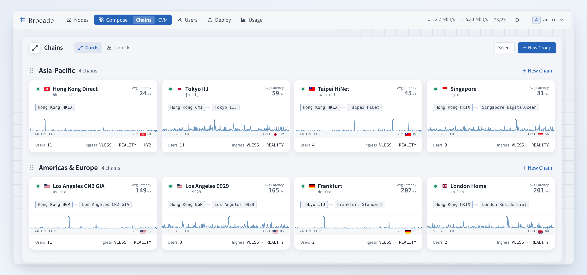
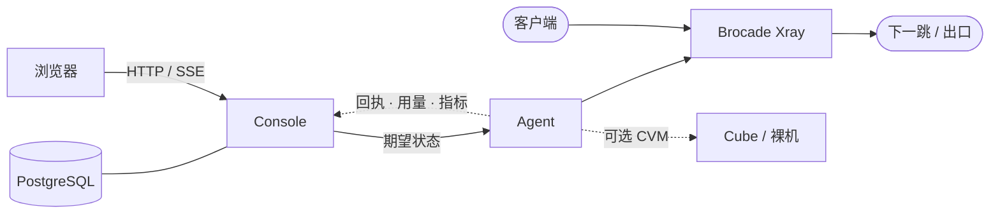

<div align="center">

<p>
  
</p>

**基于确定性编译的声明式控制面，统一编排个人跨地域计算与网络资源。**

基于统一配置编译器管理多机集群：从同一份模型为每台机器编译多跳线路、分流规则与用户授权，并可按需编排容器与裸机，由各节点 Agent 持续收敛。

[](https://github.com/akiasprin/brocade/releases/latest)
[](components/xray-core/BROCADE_UPSTREAM.toml)
[](docs/install.md)
[](docs/install.md#产品变体与扩展切换)
[](LICENSE)

[核心能力](#核心能力) · [安装与更新](#安装与更新) · [协议与数据面](#协议与数据面) · [工作原理](#工作原理) · [文档](#文档) · [仓库](#仓库)

</div>

<p align="center">
  
</p>

## 核心能力

- **声明式编排与多跳路由** — 用同一份模型管理入口、中继与出口；拓扑由规则自动推导，草稿提交形成不可变修订，支持按波次发布与准确回滚。
- **GeoData 与规则 DNS** — 内置 GeoSite / GeoIP 分组浏览器、域名反查、分类包含关系与品牌图标索引；支持规则 DNS 分组、本机 DNS 策略与出口拨测。
- **自维护 Xray 数据面** — 基于 Xray `v26.10.31`，内建 AnyTLS、MTProxy、按用户撤销会话、嗅探失败路由、站点统计与可选进程交接 Beta。
- **用户、订阅与流量账本** — 授权变更走独立通道同步运行中用户，无需重写整机配置；支持多客户端订阅、端口转发、接入配额、在线设备与出流量站点统计。
- **全机队观测与 IP 养护** — 实时速率、历史指标、Ping 延迟、公网 IP 与下线通知；离线期间本地队列补报并去重；支持机器自身出口 IP 养护与 Gemini 地区养护。
- **可选 CVM 容器与裸机** — `cvm` 变体提供「访问入口 | 计算 | 出口」三栏组合台，统一编排 Cube 轻量容器与无隔离裸机实例。

## 安装与更新

Brocade 提供两种同源码构建的产品变体，覆盖 Linux `x86_64` / `aarch64` 的 GNU 与静态 musl 共 8 组发行包：

| 变体   | 默认安装 | 包含范围                                                                               | 适用场景                                   |
| ------ | :------: | -------------------------------------------------------------------------------------- | ------------------------------------------ |
| `base` |    ✅    | 完整代理网络控制面、GeoData 路由、用户订阅、端口转发、观测与 IP 养护；不含 CVM 与 Cube | 绝大多数自建多地域 Xray 网络与机队管理     |
| `cvm`  |          | 包含 `base` 全部能力 + 容器/裸机组合台、CVM 网络编译、容器使用授权与双变体 Agent 分发  | 需要在同一控制台同时编排轻量容器或裸机实例 |

### 安装

在 Linux 服务器上复制执行以下命令，自动下载最新正式版中适合 CPU 架构的 `base` 静态安装包，校验 SHA-256 后启动交互安装：

```sh
(
  set -eu
  case "$(uname -s):$(uname -m)" in
    Linux:x86_64|Linux:amd64) arch=x86_64 ;;
    Linux:aarch64|Linux:arm64) arch=aarch64 ;;
    *) echo '仅支持 Linux x86_64 / aarch64' >&2; exit 1 ;;
  esac
  repo=https://github.com/akiasprin/brocade
  release=$(curl -fsSL --connect-timeout 15 --max-time 60 -o /dev/null -w '%{url_effective}' "$repo/releases/latest")
  version=${release##*/v}
  printf '%s\n' "$version" | grep -Eq '^[0-9]+\.[0-9]+\.[0-9]+$'
  case $version in
    0.3.[1-5]) bundle=brocade-dist-$version-linux-$arch-musl ;;
    *) bundle=brocade-dist-$version-base-linux-$arch-musl ;;
  esac
  work_dir=$(mktemp -d)
  trap 'rm -rf "$work_dir"' 0
  trap 'exit 130' INT
  trap 'exit 143' HUP TERM
  cd "$work_dir"
  url=$repo/releases/download/v$version/$bundle.tar.gz
  curl -fL --retry 2 --connect-timeout 15 --max-time 600 -o "$bundle.tar.gz" "$url"
  curl -fL --retry 2 --connect-timeout 15 --max-time 60 -o "$bundle.tar.gz.sha256" "$url.sha256"
  sha256sum -c "$bundle.tar.gz.sha256"
  tar -xzf "$bundle.tar.gz"
  if [ "$(id -u)" -eq 0 ]; then
    sh "$bundle/install.sh"
  else
    sudo sh "$bundle/install.sh"
  fi
)
```

需要 `curl`、`tar` 和 `sha256sum`。静态 musl 包兼容同架构 GNU 与 musl 系统。安装器可托管 PostgreSQL，默认监听 `0.0.0.0:8080`，启动后输出初始化链接，入门向导带你纳管第一台机器。安装容器版（`cvm`）、GNU 包或手动下载见[安装与升级](docs/install.md)。

### 更新

通过官方安装器部署的 v0.3.6 及以后版本，在原 Console 服务器执行以下命令，自动获取最新正式版并保留已安装的 `base` / `cvm` 变体：

```sh
(
  set -eu
  case "$(uname -s):$(uname -m)" in
    Linux:x86_64|Linux:amd64) arch=x86_64 ;;
    Linux:aarch64|Linux:arm64) arch=aarch64 ;;
    *) echo '仅支持 Linux x86_64 / aarch64' >&2; exit 1 ;;
  esac
  flavor=$(cat /etc/brocade/product-flavor)
  case $flavor in
    base|cvm) ;;
    *) echo '无法识别已安装的产品变体，请检查原安装' >&2; exit 1 ;;
  esac
  repo=https://github.com/akiasprin/brocade
  release=$(curl -fsSL --connect-timeout 15 --max-time 60 -o /dev/null -w '%{url_effective}' "$repo/releases/latest")
  version=${release##*/v}
  printf '%s\n' "$version" | grep -Eq '^[0-9]+\.[0-9]+\.[0-9]+$'
  bundle=brocade-dist-$version-$flavor-linux-$arch-musl
  work_dir=$(mktemp -d)
  trap 'rm -rf "$work_dir"' 0
  trap 'exit 130' INT
  trap 'exit 143' HUP TERM
  cd "$work_dir"
  url=$repo/releases/download/v$version/$bundle.tar.gz
  curl -fL --retry 2 --connect-timeout 15 --max-time 600 -o "$bundle.tar.gz" "$url"
  curl -fL --retry 2 --connect-timeout 15 --max-time 60 -o "$bundle.tar.gz.sha256" "$url.sha256"
  sha256sum -c "$bundle.tar.gz.sha256"
  tar -xzf "$bundle.tar.gz"
  if [ "$(id -u)" -eq 0 ]; then
    sh "$bundle/install.sh" --upgrade
  else
    sudo sh "$bundle/install.sh" --upgrade
  fi
)
```

升级保留原配置、数据库和密钥，安装器会停服备份、执行缺少的迁移并检查启动结果。若要求失败后只向前修复，在两处 `--upgrade` 后追加 `--forward-only`；停服后失败会保留现场并保持停服。更早版本、变体切换、外部数据库客户端要求与备份恢复说明见[安装与升级](docs/install.md#升级)。

> [!IMPORTANT]
> Agent 以 root 身份修改机器的网络与系统配置。用于生产前，请先审查生成的配置、访问控制和部署边界。

## 协议与数据面

Brocade 只支持仓库内维护的 Xray fork（[`components/xray-core`](components/xray-core)，上游基线 **v26.10.31**）。它在上游之上增加了 AnyTLS、MTProxy、进程间监听交接、按用户撤销会话、嗅探失败路由、站点用量统计与机器/用户限流等能力。Console 构建时把双架构的 Agent 与 Xray 嵌入自身，并以实际字节的摘要作为发布身份。

| 环节 | 支持                                                                                           |
| ---- | ---------------------------------------------------------------------------------------------- |
| 接入 | VLESS（REALITY / TLS，TCP / XHTTP）、AnyTLS（TLS / REALITY）、Hysteria2（含端口跳跃）、MTProxy |
| 中转 | VLESS Encryption、REALITY、Shadowsocks 2022、WireGuard                                         |
| 出口 | 直连、自定义隧道、Cloudflare WARP（MASQUE HTTP/3 & HTTP/2）、VPN Gate                          |

## 工作原理

管理几十台代理机器，难点很少是写出一份配置，而是回答这些问题：这次改动会影响哪些机器？线上实际运行的是哪个版本？出了问题能否准确回到之前的状态？某台机器失联期间发生了什么？

Brocade 的做法是：所有意图写进同一份模型；配置由模型推导，从不手工维护；每次发布都指向一个不可变的修订；机器只接收“应当是什么样”，自己负责“变成那样”。



Console 是唯一的控制入口：保存草稿、修订与发布记录，编译产物，默认用同一个端口服务浏览器与 Agent。Agent 主动轮询期望状态（支持 ETag 条件请求），实时数据经 WebSocket 上行；浏览器只通过 Console 的 SSE 读取，从不直接连接机器。

### 设计约束

1. **编译是纯函数。** `brocade-core`（及容器版的 `brocade-cvm-compile`）不访问数据库、文件系统或网络；相同版本和输入产生逐字节一致的产物。发布预览、历史修订重编译和回归测试都建立在这一点上。
2. **修订不可变。** 编辑先进入草稿，提交后形成修订；回滚以历史修订为目标创建新的发布，不改写任何记录，并保留运行会话、常态限速与探测数据。
3. **收敛而非执行。** Agent 接收期望状态，与本机实际状态比较，只在有偏差时执行幂等操作；中断后重试即可恢复。
4. **拓扑由规则推导。** 线路路径来自入口位置、逐跳转发规则和显式监听引用，不另存一份可能与规则矛盾的拓扑。
5. **发布分域。** 配置、授权、Agent、Xray、Cube 与 Console 各有独立的发布路径和回滚方式，风险与代价不同，互不顺带。

<details>
<summary>一次变更的路径与节点失联处理</summary>

**一次变更的路径**

1. 在控制台编辑，改动写入草稿；一次界面操作涉及的多张表在同一事务中修改。
2. 提交草稿得到不可变修订。Console 编译出每台机器的产物，并与当前线上修订比较。
3. 发布按影响范围分成波次；默认开启无人值守按波次推进（关闭后含破坏性操作的波次等待操作者确认），执行错误会立即暂停发布。
4. Agent 轮询到新的期望状态后在本机收敛：能热更新的经 Xray API 完成；结构变化默认重启生效，开启「Xray 进程交接」Beta 后由新旧进程交接监听（旧 TCP 最多保留 120 秒，Agent v40 起条件不足时在校验与计量后降级重启）。
5. Agent 回报执行回执，全部目标确认后发布完成。授权变更不走这条路径：Console 只比较账户投影，排队后由 Agent 直接更新运行中 Xray 的用户，不生成完整配置。

**失联时**

- Agent 把最近一次期望状态保存在本地，控制面不可达时仍能纠正本机漂移。
- 用量和指标先写入本地有界队列，恢复后按序补报；重复窗口由数据库去重，不会重复记账。
- 实时速率只在有人查看时采集，不落库，也不参与补报。
- 连续 90 秒没有轮询的机器记为下线，并产生通知。

</details>

## 文档

- **部署与开发**：[安装与升级](docs/install.md)（发行包、变体切换、初始化与备份） · [手动部署](docs/manual-deployment.md)（systemd 与 Nginx） · [从源码构建](docs/build.md)（工具链、发行构建与前端开发）
- **控制面与网络**：[模型、修订与发布](docs/concepts.md)（确定性编译、隔离与发布单） · [接入与出口](docs/routing.md)（GeoData、DNS 组、WARP 与拨测） · [VPN Gate](docs/vpngate.md) · [端口转发](docs/forwarding.md)
- **用户与观测**：[用户、访问与订阅](docs/users.md)（访客视图、配额与在线设备） · [用量与实时流量](docs/traffic.md) · [出流量统计](docs/site-usage.md) · [机器观测与通知](docs/observability.md) · [机器 IP 养护](docs/ip-maintenance.md)
- **容器扩展（CVM）**：[CVM](docs/cvm.md)（组合台、宿主、网络与用户额度） · [裸机实例](docs/baremetal.md)（无容器隔离的整机纳管） · [Cube 节点运行栈](docs/cube-runtime.md)（源码基线与构建入口）

## 仓库

| 路径                         | 职责                                                                  |
| ---------------------------- | --------------------------------------------------------------------- |
| `crates/brocade-core`        | 纯函数编译器：模型快照 → IR → 节点产物；Golden 产物在 `tests/golden/` |
| `crates/brocade-cvm-compile` | CVM 声明式编译器：实例、宿主机网络、访问入口与出口路由产物            |
| `crates/brocade-store`       | PostgreSQL：草稿、修订、发布、凭据、配额与用量                        |
| `crates/brocade-console`     | 管理端与节点端 API、实时通道；内嵌前端、Agent 与 Xray                 |
| `crates/brocade-deployment`  | 发布计划与 Console / Agent 共享协议                                   |
| `crates/brocade-agent`       | 机器侧收敛、观测、探测、IP 养护、自更新与离线缓冲                     |
| `crates/brocade-cube`        | Cube 节点运行栈客户端与 Guest I/O 协议层                              |
| `crates/brocade-probe`       | Console 与 Agent 共用的临时 Xray 拨测                                 |
| `crates/brocade-launcher`    | `brocade` 命令：启动 Console 与托管 PostgreSQL                        |
| `crates/brocade-sqlx`        | 只含 PostgreSQL 驱动的 SQLx 门面                                      |
| `crates/brocade-preview`     | 基于 Docker 的本地集群预览                                            |
| `frontend`                   | React + Vite 控制台                                                   |
| `components/xray-core`       | Brocade Xray fork                                                     |
| `components/cube`            | Cube 节点运行栈                                                       |

```sh
cargo test --workspace --locked
cd frontend && npm ci && npm test
```

构建见[从源码构建](docs/build.md)；验证矩阵与工程约定见 [AGENTS.md](AGENTS.md) 和 [`.agents/`](.agents/README.md)。

## 许可证

Brocade 自有代码采用 [Apache License 2.0](LICENSE)。`components/xray-core` 是 [Xray-core](https://github.com/XTLS/Xray-core) 的 fork，遵循 [MPL-2.0](components/xray-core/LICENSE)，固定的上游基线见 [BROCADE_UPSTREAM.toml](components/xray-core/BROCADE_UPSTREAM.toml)。`components/cube` 来自 [CubeSandbox](https://github.com/tencentcloud/CubeSandbox)，保留上游模块路径与对应许可证（见 [LICENSE](components/cube/LICENSE) 与 [BROCADE_UPSTREAM.toml](components/cube/BROCADE_UPSTREAM.toml)）。
